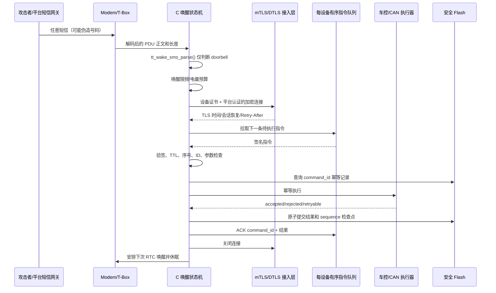

# 车辆 T-Box 安全唤醒与加密拉取参考实现

这个工程把原来的“短信携带并执行指令”改成：

```text
伪造者可发送的短信
        │
        ▼
  仅识别为唤醒信号
  （不信号码、不取指令）
        │
        ▼
  限频 + 电量/时间预算
        │
        ▼
  主动建立双向认证加密通道
        │
        ▼
  平台拉取待执行指令 + 验签/防重放
        │
        ▼
  幂等执行 → 持久化检查点 → ACK → 立即休眠
```

核心代码是可移植 C11，不依赖某个 Modem SDK 或 TLS 库；硬件、TLS、Flash 操作通过 `tt_gateway_t` / `tt_storage_t` 接口注入。仓库自带主机端单元测试、ASan/UBSan 验证和一个可运行 demo。

## 1. 安全边界

### 旧流程的问题

短信发送号码可以伪造，短信正文也能被构造为“格式正确 + 指令字段”。如果固件从短信中直接取指令并调用车控接口，等于允许任何能发短信的人触发解锁、空调等操作。

### 新流程的信任规则

1. **短信号码不是身份凭证**：不使用发件号码做授权，也不根据号码决定是否执行。
2. **短信正文没有指令字段**：唯一专用格式是：

   ```text
   TT-WAKE/1
   TT-WAKE/1 0123456789abcdef
   ```

   16 位 hex nonce 只用于日志关联和唤醒统计，不参与授权。
3. **伪造短信最多只能触发一次“醒来并尝试联网”**：本地唤醒限频器限制窗口内的无线上电次数，避免短信洪峰耗电。
4. **所有车控指令只从认证加密通道拉取**：生产环境建议 TLS 1.3 + 设备证书/安全元件双向认证，或 NB-IoT 场景下的 DTLS 1.2/1.3 + CoAP。
5. **平台指令仍需应用层签名**：即使 TLS 端点或网关被绕过，终端也只信任预置平台公钥签名的规范化指令字节。
6. **防重放**：每条指令包含设备内单调 `sequence`、全局唯一 `id`、签发时间和过期时间；Flash 保存最后序号、最后 ID 和终端结果。
7. **幂等执行**：平台可能重投、ACK 可能丢失、执行结果响应也可能丢失，因此车控执行接口必须以 `command_id` 为幂等键。
8. **最小指令集**：只允许落锁、解锁、空调、寻车等显式枚举；空调温度等参数做范围检查，不提供 shell、AT 透传、文件路径或任意 CAN 报文执行能力。

> 注意：唤醒 token 本身不是密钥。它只能降低普通短信/噪声误唤醒概率，不能阻止攻击者故意发送唤醒短信。限频、短窗口和平台容量设计用于控制这种“只能耗电、不能控车”的影响。

## 2. 时序



## 3. 代码结构

| 文件 | 职责 |
|---|---|
| `include/tt/wake_sms.h` / `src/tt_wake_sms.c` | 严格长度的唤醒短信解析、唤醒限频器 |
| `include/tt/retry.h` / `src/tt_retry.c` | 单调截止时间、剩余窗口判断、full-jitter 指数退避、平台 `Retry-After` |
| `include/tt/command.h` / `src/tt_command.c` | 指令结构、签名验证钩子、TTL/参数校验、序号重放检查 |
| `include/tt/wake_flow.h` / `src/tt_wake_flow.c` | 一次唤醒窗口的完整有界状态机、ACK/幂等/存储/休眠调度 |
| `tests/test_all.c` | 主机端单元和状态机测试，包含断网、过载、重复、重放、失败重试 |
| `examples/demo_main.c` | 可运行的内存 HAL demo |

## 4. 构建和测试

```bash
make test     # 构建并运行全部测试
make demo     # 运行演示流程
make          # 构建测试和 demo
make clean
```

已在 macOS/clang 下使用以下选项通过：

```text
-std=c11 -Wall -Wextra -Wpedantic -Werror
```

并通过 AddressSanitizer + UndefinedBehaviorSanitizer。

## 5. 移植到固件时需要实现的 HAL

### 5.1 Modem 与短信

- 在 Modem URC（如 `+CMT` / `+CMTI`）或开机后读取短信。
- 先完成 PDU/UCS-2 解码，向 `tt_wake_sms_parse()` 传入**解码后字节和真实长度**。
- 不要把发件号码传入授权判断。
- AT 命令必须使用固定格式和有界缓冲区，禁止 `system()` / `popen()` / 字符串拼接未过滤内容。
- 优先配置 Modem 的短信过滤/存储能力，使无效短信不必唤醒主 MCU。

### 5.2 加密通道

实现 `tt_gateway_t.connect/pull_next/ack/disconnect`：

- 使用 TLS 1.3 或 DTLS 1.2/1.3。
- 预置平台根证书/中间证书，校验域名、有效期、CRL/OCSP 或固件内吊销列表。
- 设备私钥最好放在 SE/TPM/eSIM 中，支持 mTLS。
- 启用 TLS session resumption，减少弱网下完整握手的电量和时延。
- 从认证后的 TLS 时间、HTTP `Date` 或安全 RTC 提供 `trusted_unix_ms()`。
- 生产环境必须安装非空 `validation.verify_signature`，例如 Ed25519/ECDSA 验签；示例中的 `verify_ok` 只能用于测试。

### 5.3 Flash 存储

实现 `tt_storage_t`：

- `commit_result()` 必须把 `command_id` 结果和每设备 `last_sequence/last_command_id` 放在同一个原子事务/A-B 日志中。
- 使用带 CRC/ECC 的键值区或双 sector 日志，避免写一半掉电。
- 做磨损均衡，不要固定地址频繁覆写结构体。
- 保存一个有界的最近 `command_id -> result` 缓存，用于处理序号较旧但 ACK 丢失的重投。
- 跨唤醒周期持久化连续网络失败次数，进一步拉长 RTC 唤醒间隔。

### 5.4 车控执行器

`execute(command_id, command)` 必须幂等：

- 车身控制器维护有界已执行指令 ID/结果缓存；或
- 将 `command_id` 作为 CAN/UDS 操作的幂等键/诊断事务标识；或
- 对状态类指令（落锁、空调温度）先读当前状态，使重复调用不产生额外动作。

遇到 CAN 总线繁忙、执行器未就绪等临时错误，返回 `TT_ACK_RETRYABLE`；参数或安全条件不满足则返回 `TT_ACK_REJECTED`。

### 5.5 平台接口契约示例

具体 HTTP/JSON 或 MQTT/CBOR 可按平台替换，但建议保持以下语义：

```http
POST /v1/devices/VIN-or-device-id/session
TLS client certificate: required

200 OK
{ "server_time_ms": 1790000000000, "session_resume": true }

GET /v1/devices/.../commands?wait_ms=0
200 OK
{
  "command": {
    "id": "cmd_01J...",
    "sequence": 8123,
    "issued_at_ms": 1790000000000,
    "expires_at_ms": 1790000060000,
    "type": "set_climate",
    "params": { "target_temp_c": 22 }
  },
  "canonical_payload_b64": "...",
  "signature_b64": "..."
}

POST /v1/devices/.../commands/cmd_01J.../acks
{ "code": "accepted|rejected|retryable|duplicate", "vehicle_error": 0 }
```

过载时返回：

```http
HTTP/1.1 503 Service Unavailable
Retry-After: 37
```

或在 MQTT `CONNACK`/`DISCONNECT` reason、命令响应中携带等价退避时间。`canonical_payload` 必须是签名覆盖的同一字节序列；车端验签后再解析参数，避免解析器与验签输入不一致。

## 6. 弱网、唤醒窗口和电量设计

默认配置是一组可按车型调整的保守起点：

```c
session_budget_ms          = 120 s
attempt_reserve_ms         = 30 s
max_attempts               = 5
initial_backoff            = 0.5 s
max_backoff                = 15 s
first_connect_jitter       = 0..5 s
connect_timeout            = 12 s
pull_timeout               = 10 s
ack_timeout                = 5 s
execute_timeout            = 5 s
max_commands_per_wake      = 8
pending_wake_delay         = 10 s + 0..25% jitter
```

状态机保证：

- 所有等待都受单调截止时间约束，不会无限重试。
- 每次尝试前确认至少剩余一次操作和优雅关链的预留时间。
- 使用 full-jitter 指数退避，避免大量终端按同一节奏重连。
- 平台通过认证通道返回 `Retry-After` / MQTT reason / HTTP 503 时，终端优先遵守。
- 如果平台提示的时间超过当前窗口，不再硬试，直接安排下一次 RTC 唤醒。
- 临时车控失败会停止拉取后续可能有顺序冲突的指令，ACK `retryable` 后休眠等待重投。
- 成功、永久拒绝、可重试失败、重复指令分别计数，便于平台和车端诊断。

现网调优建议：

- 对用户主动触发的解锁/空调，平台应优先排队并控制群发短信节奏；终端可用较短首次 jitter。
- 对批量运营任务，使用更大的设备侧 jitter（例如按 `hash(device_id, campaign_id)` 分散到数分钟），平台也应分批发送 wake SMS。
- 弱网地区可缓存多条指令并使用批量拉取/累积 ACK，减少无线电 RRC 状态切换；本参考的 `pull_next/ack` 可由“内部预取一批”的适配器支撑。
- 若连续多个唤醒周期数据失败，应把跨周期退避拉长到 1、2、5、15、30 分钟并设置上限，同时保留平台再次发短信即时唤醒的能力。
- 记录每次唤醒的短信解析结果、连接耗时、TLS 握手结果、RSSI/RSRP、失败原因和电量消耗，用于发现某地区运营商/基站问题。

## 7. 海量车辆同时唤醒时平台如何扛住

设备侧 jitter 只能削峰，平台仍需按脉冲到达设计。

### 7.1 接入和队列架构

```text
Wake SMS 发送限速器
        │  按接入容量分批发送
        ▼
DNS/Anycast/L4 LB
        │
TLS/mTLS 接入层（无状态、HPA、多 AZ）
        │  TLS session ticket / 分布式 session cache
        ▼
MQTT Broker 集群 或 HTTPS API Gateway
        │
一致性分片 / Kafka / Pulsar（key=device_id）
        │
每设备有序命令队列 + 幂等表
        │
命令服务/车控状态服务/推送通知
```

关键原则：

- **wake SMS 也要限速发送**：批量活动不要同一秒向全量车辆发送；按 TLS 接入层可承受的握手速率反压短信网关。
- **接入层水平扩展**：mTLS 握手是 CPU 密集型，按新建连接速率、握手队列、CPU 和文件描述符数扩容，而不是只按 CPU 平均利用率。
- **开启 TLS1.3 session resumption**：大量重连可跳过昂贵的证书验证和非对称握手。
- **无状态接入 + 分布式会话缓存**：网关升级或故障时终端可重连到任意节点。
- **按 `device_id` 分片**：保证同一车辆的解锁、落锁、空调指令有序；不同车辆可并行。
- **命令持久化**：终端离线时命令留在队列中并设置 TTL；终端连接后拉取，不依赖短信承载。
- **平台幂等键**：以 `command_id` 去重，ACK 丢失不会重复控车。
- **过载保护**：网关在容量水位高时返回 HTTP 503 + `Retry-After`，或 MQTT 限流/重定向 reason；终端必须遵守。
- **降级优先级**：用户主动解锁 > 用户主动空调 > 寻车 > 批量数据采集/OTA 通知。低优先级任务在平台侧排队或延迟。
- **区域化接入**：针对弱网地区部署更近的 POP/运营商 APN/专线，减少 TCP/TLS 往返和 NAT 超时。

### 7.2 容量估算方法

不要只估算“总车辆数”，要估算脉冲到达率和并发会话数：

```text
短信/唤醒到达率 λ_wake = N / T_wake
连接成功率考虑弱网后，连接到达率 λ_conn ≈ λ_wake × retry_amplification
平均在线会话时长 S
稳态并发连接数 C ≈ λ_conn × S
```

例如 100 万辆车在 60 秒内被唤醒，平均每个 TLS 拉取会话持续 2 秒：

```text
λ ≈ 16,667 新建连接/秒
C ≈ 16,667 × 2 ≈ 33,333 并发会话
```

弱网重试可能把握手请求放大 1.5–3 倍，因此还要加上：

- TLS 握手 CPU 和带宽；
- LB/网关最大连接数；
- MQTT 集群连接数；
- 消息队列分区和消费速率；
- 命令数据库/幂等表 QPS；
- 跨 AZ 带宽；
- 故障节点被摘除后的 N+1/N+2 冗余。

上线前应使用真实设备指纹、弱网 profile、TLS 会话恢复比例和重试行为做全链路压测，并模拟：

- 同一秒唤醒全量车辆；
- 30%/50% 高延迟和丢包；
- 接入层节点宕机；
- Kafka/数据库慢节点；
- ACK 丢失；
- 平台返回 `Retry-After`；
- 重放旧指令和冲突序号。

## 8. 验收要点

- 伪造发件号码不再影响授权。
- 短信正文中附加的任意文本都不会进入 shell、CAN、UDS 或命令解析器。
- 没有有效平台签名的指令不会执行。
- 过期、未来时间、序号回退、同序号不同 ID 的指令被拒绝。
- ACK 丢失后重复拉取不会重复执行非幂等车控动作。
- 断网、TLS 失败、平台 503 时状态机在电量预算内退避或安排下次唤醒。
- 平台过载提示能被终端执行。
- Flash 写入中途掉电后检查点不损坏。
- 大批量车辆同时唤醒时，设备 jitter、平台短信限速、接入层弹性和分片队列共同削峰。

## 9. 仍需在真实项目中补齐的部分

本仓库是可测试的核心状态机，不是完整固件镜像。量产前还需要：

- 所选 Modem/RTOS 的 URC、PDU、RTC 和低功耗适配；
- mbedTLS/WolfSSL/厂商 TLS 栈与安全元件驱动；
- 平台证书/公钥预置、轮换和吊销方案；
- 安全启动、固件签名、调试口锁定；
- 真实 Flash KV/A-B 事务实现和掉电测试；
- 车身 CAN/UDS 幂等执行器集成与功能安全评审；
- 隐私合规、日志脱敏和安全事件审计；
- 故障注入、长时间弱网和车规温度/电压测试。
